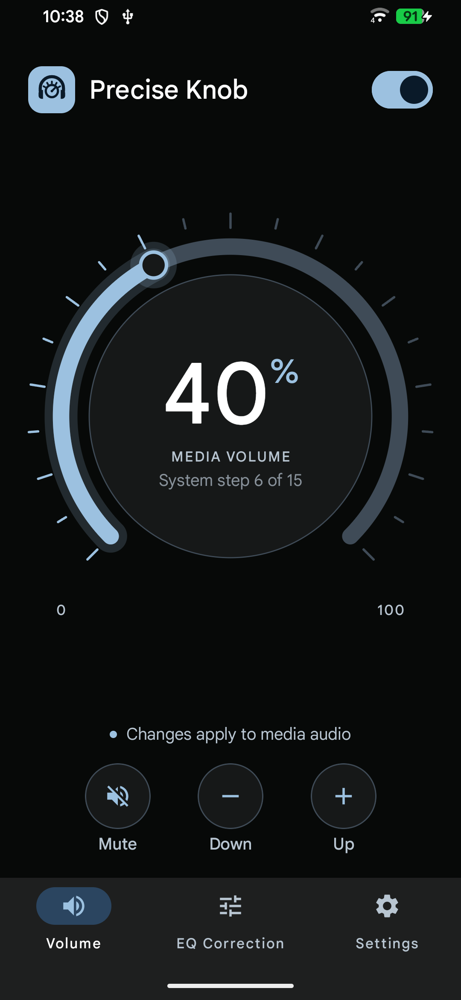
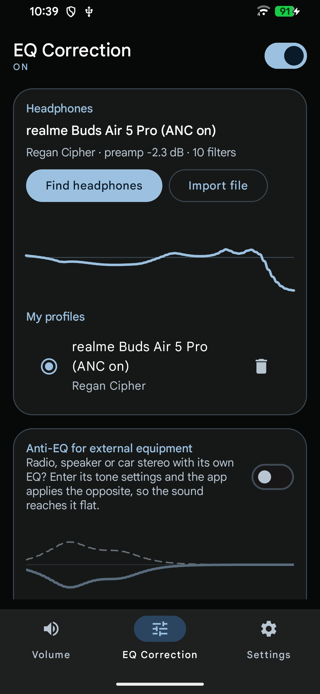
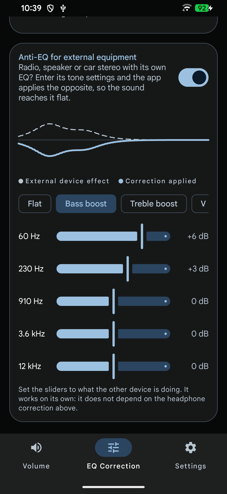
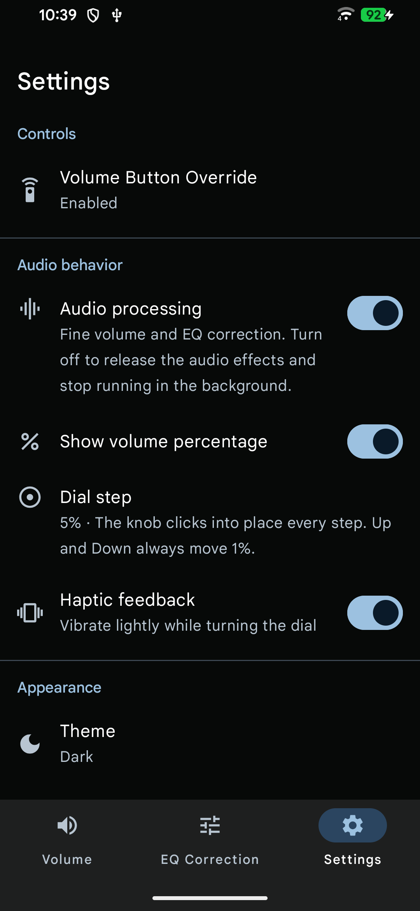

<div align="center">

# 🎛️ Precise Knob

**A rotary volume dial with 1 % steps, and AutoEq headphone correction, for Android.**

[](../../releases/latest)
[](#install)
[](#build-from-source)
[](docs/design-system.md)

<br>


&nbsp;

&nbsp;

&nbsp;


</div>

<br>

Android gives you about 15 volume steps. **Precise Knob** gives you 100: a hand-feel rotary dial that moves the media volume 1 % at a time, plus equalizer profiles from the [AutoEq](https://github.com/jaakkopasanen/AutoEq) project so your headphones sound flat, and an anti-EQ for the radio or speaker you plug into.

## ✨ Features

### 🔊 Fine volume
- **Rotary dial** with 270° arc, drag or tap, tick marks and optional percentage readout.
- **1 % resolution** on top of the system's native steps, using a global audio effect to attenuate between steps.
- **Configurable detents** (1, 2, 5 or 10 %) with a haptic click on every step, stronger every 10 % and at the ends.
- Mute / Down / Up buttons; Mute remembers your previous level.

### 🎧 EQ Correction
- **Headphones card**: search ~8,800 models from AutoEq, download the profile in one tap, or import any `ParametricEQ.txt`. The response curve is drawn from the real filters.
- **Anti-EQ card**: tell the app what your radio, speaker or car stereo is doing to the sound (5 bands, ±12 dB, with presets) and it applies the opposite. The chart shows the device's effect (dashed) against the correction applied.
- Independent switches: use headphone correction, anti-EQ, or both together.

### 🔘 Volume Button Override *(beta)*
Make the **physical volume keys** move the volume in fine steps in any app, with a custom popup (three styles, left or right side). Configurable for unlocked, locked and screen-off states. Uses an accessibility service that only filters key events; it does not read screen content.

### 🎨 Design
Steel blue Material 3 theme, dark by default with light and system modes.

## 📲 Install

1. Download `PreciseKnob-1.0.0.apk` from the [latest release](../../releases/latest).
2. Open it on your phone and allow installing from your browser or file manager if asked.
3. On first launch, allow notifications (needed for the background audio service).

Requires **Android 9 (API 28) or newer**.

### If Android complains during install or setup
Because the APK does not come from Google Play, Android adds two safeguards. Both are one-time steps:

- **Play Protect blocks the install** ("unknown developer"): tap *More details → Install anyway*. You do not need to turn Play Protect off.
- **"Restricted setting" when enabling the Volume Button Override** (Android 13+): open *Settings → Apps → Precise Knob*, tap the **⋮** menu (top right) → **Allow restricted settings**, then go back to *Accessibility* and turn the service on. If the menu is missing, open the accessibility service once first so the warning appears. The app has a shortcut to the app info on the override screen.

> **Heads up:** fine volume and EQ rely on Android's global audio effects. Not every device or ROM honours them; the app detects this and falls back to the native steps. Tested on a Redmi Note 8 Pro and a Realme RMX3370.

## 🛠️ Build from source

```bash
export JAVA_HOME="/path/to/jdk17"
./gradlew :app:testDebugUnitTest :app:assembleDebug     # debug APK in app/build/outputs/apk/debug/
./gradlew :app:assembleRelease                           # signed if keystore.properties exists
```

Needs JDK 17 and the Android SDK (compileSdk 36); create `local.properties` with `sdk.dir=...` or open the project in Android Studio. Release signing and troubleshooting are covered in [docs/build.md](docs/build.md).

## 🗂️ Project layout

```
app/src/main/java/com/precisevolumedial/app/
  audio/      volume mapping, audio effects engine, eq/ (AutoEq parser, biquads, anti-EQ)
  data/       settings (DataStore), AutoEq client, profile repository
  override/   volume key service (accessibility), rules, popup
  ui/         theme (steel blue), components (dial, EQ widgets), one folder per screen
```

More in [docs/](docs/README.md): [architecture](docs/architecture.md) · [features](docs/features.md) · [design system](docs/design-system.md) · [roadmap](docs/roadmap.md).

## 🙏 Credits

Headphone profiles come from the [AutoEq](https://github.com/jaakkopasanen/AutoEq) project by Jaakko Pasanen and contributors. They are measurement-based estimates, so results vary by unit.
